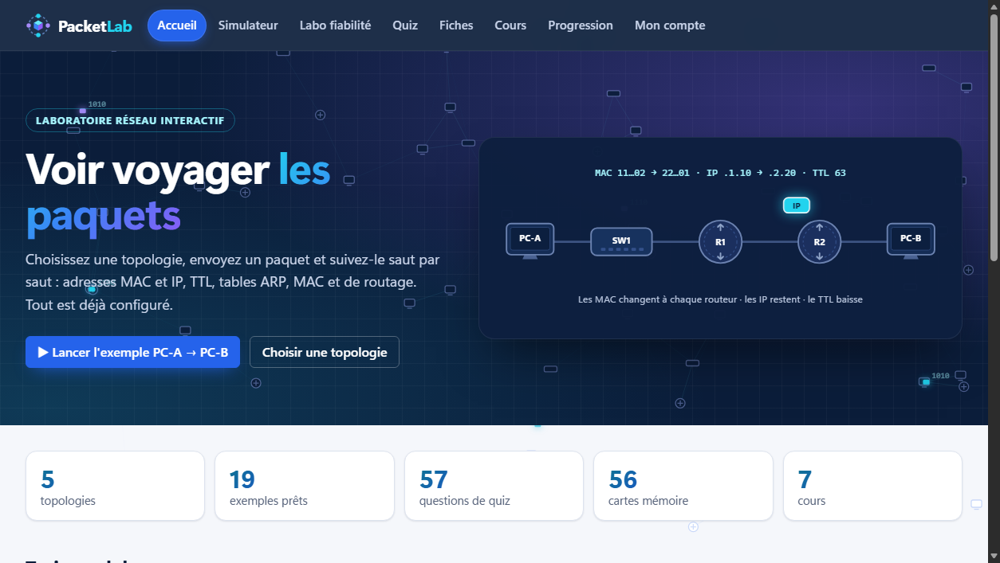
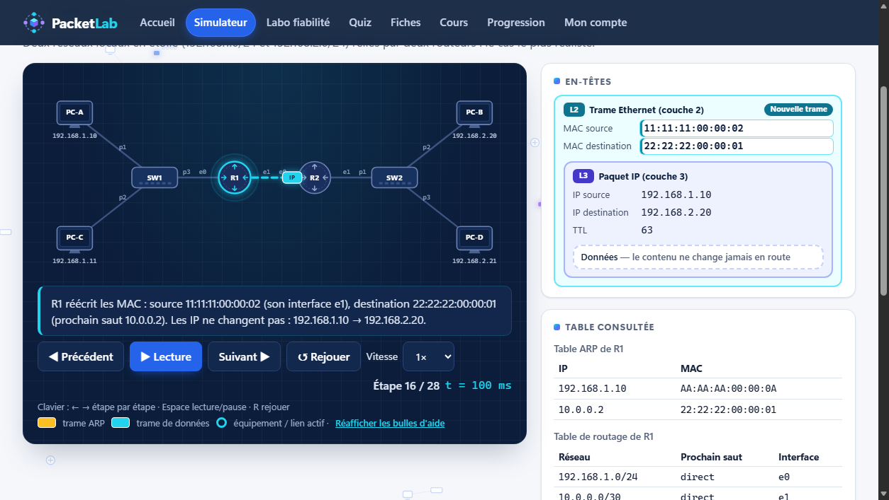
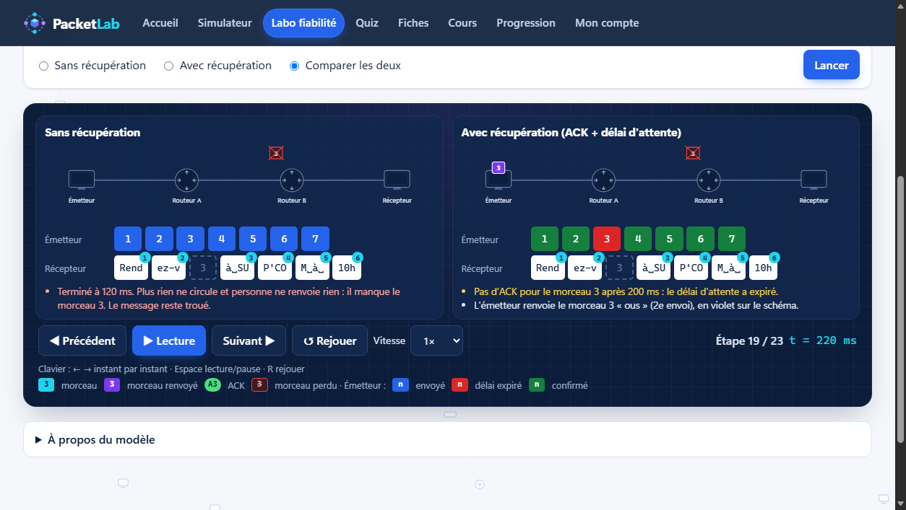
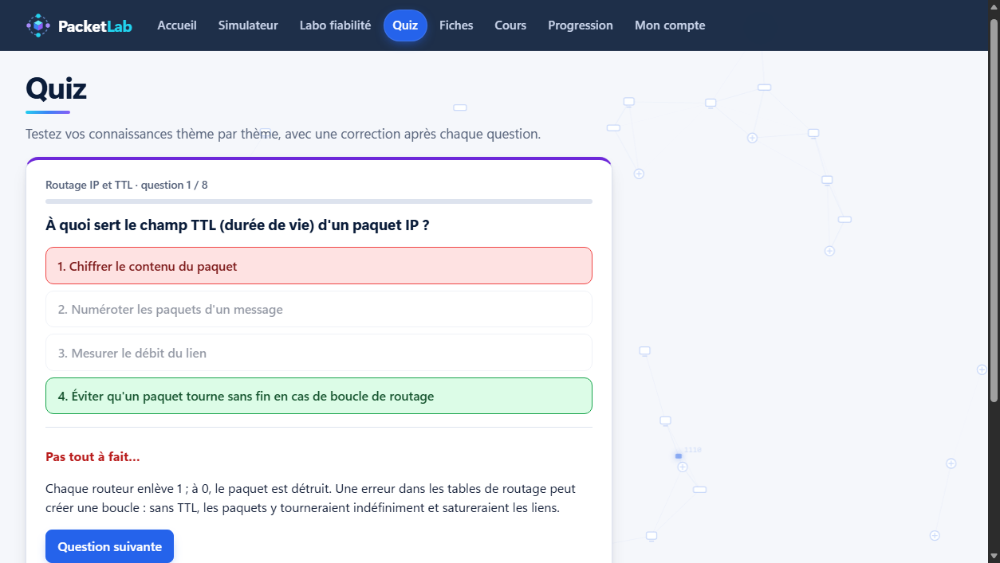

# PacketLab

**Apprendre les réseaux en voyant voyager les paquets.**
Choisissez une topologie, envoyez un paquet et suivez-le saut par saut : adresses MAC et IP, TTL, tables ARP, MAC et de routage. Tout est déjà configuré.

### ▶ [Ouvrir PacketLab](https://bahakh-io.github.io/PacketLab/)

Fonctionne dans le navigateur, sur ordinateur comme sur téléphone, sans installation.

| | |
|---|---|
|  |  |
|  |  |

---

## Ce qu'on y trouve

| | |
|---|---|
| **Voyage d'un paquet** | 5 topologies (étoile, bus, anneau, maillée, mixte) et 19 exemples prêts, pannes comprises. Lecture pas à pas, en-têtes et tables à chaque saut, questions en cours de route, mode « Prédire d'abord ». |
| **Labo fiabilité** | Un message découpé en morceaux : on en perd un, on en retarde un autre, puis on compare la livraison sans et avec acquittements et réémission. |
| **Apprendre et s'évaluer** | 7 cours, 8 fiches, 56 cartes mémoire, 57 questions de quiz corrigées, et une page de progression. |
| **Comptes étudiants** | Facultatifs : la progression (« labs réalisés ») est gardée sur le compte et retrouvée sur chaque appareil. |

## Sous le capot

- **HTML, CSS et JavaScript** (modules ES) : aucun framework, aucune dépendance, aucune étape de compilation.
- **Un moteur à événements discrets** (`js/engine/`) calcule toute la simulation ; l'interface ne fait que rejouer la liste d'événements. Pause, retour en arrière et rejeu restent donc toujours cohérents.
- **Un backend léger** (`server/`) pour les comptes : le même code tourne sur Cloudflare Workers + D1 en ligne, et avec le SQLite intégré à Node en local. Mots de passe hachés (PBKDF2), sessions à jetons. Détails : [`docs/backend.md`](docs/backend.md).
- **97 tests** (`node --test`) : règles réseau, exemple travaillé, scénarios, contenus pédagogiques, backend.

## Lancer en local

```sh
# Le site : ouvrir le dossier dans VS Code, puis « Open with Live Server » sur index.html
# (les fichiers JSON ne se chargent pas en double-cliquant sur la page).

node --test                                   # tous les tests
node tests/print-log.js mixte PC-A PC-B       # un trajet dans le terminal
node tests/print-log.js mixte --scenario boucle
node tests/print-reliability.js avec perdre:3 # le labo fiabilité dans le terminal
node server/dev-server.js                     # (facultatif) l'API des comptes, sur 127.0.0.1:8787
```

## Organisation

```
index.html  simulateur.html  fiabilite.html  quiz.html  fiches.html  cours.html  progression.html  connexion.html
js/engine/   le moteur (aucun accès à la page)      data/topologies/  les 5 topologies et leurs exemples
js/ui/       l'affichage de chaque page             data/quiz, data/fiches, cours/   les contenus
server/      l'API des comptes                       tests/            les tests
docs/        plan, formats des données, backend
```

## Ce qui est simplifié

PacketLab montre les mécanismes, pas un réseau réel complet :
routes statiques uniquement (pas de RIP ni d'OSPF) ; pas de NAT ni d'ICMP ; les entrées ARP n'expirent pas pendant une simulation ; le bus ne simule pas les collisions ; le Labo fiabilité n'est pas TCP (morceaux numérotés, un acquittement par morceau, temporisateur fixe).

## Équipe

Projet Web — SUP'COM, 2026/2027 · **Baha Eddine Khantouch** et **Nour El Houda Fodha** · encadré par **Mme Nesrine Zaghdoud**.
Les cours, fiches et quiz sont des textes originaux, écrits d'après le programme des cours de réseaux de SUP'COM.
