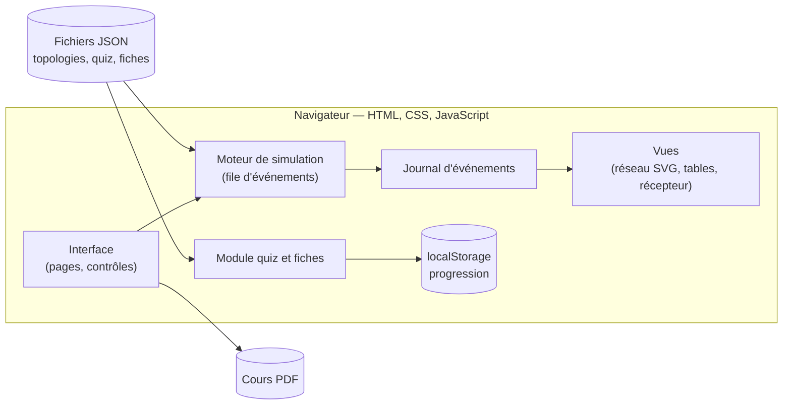
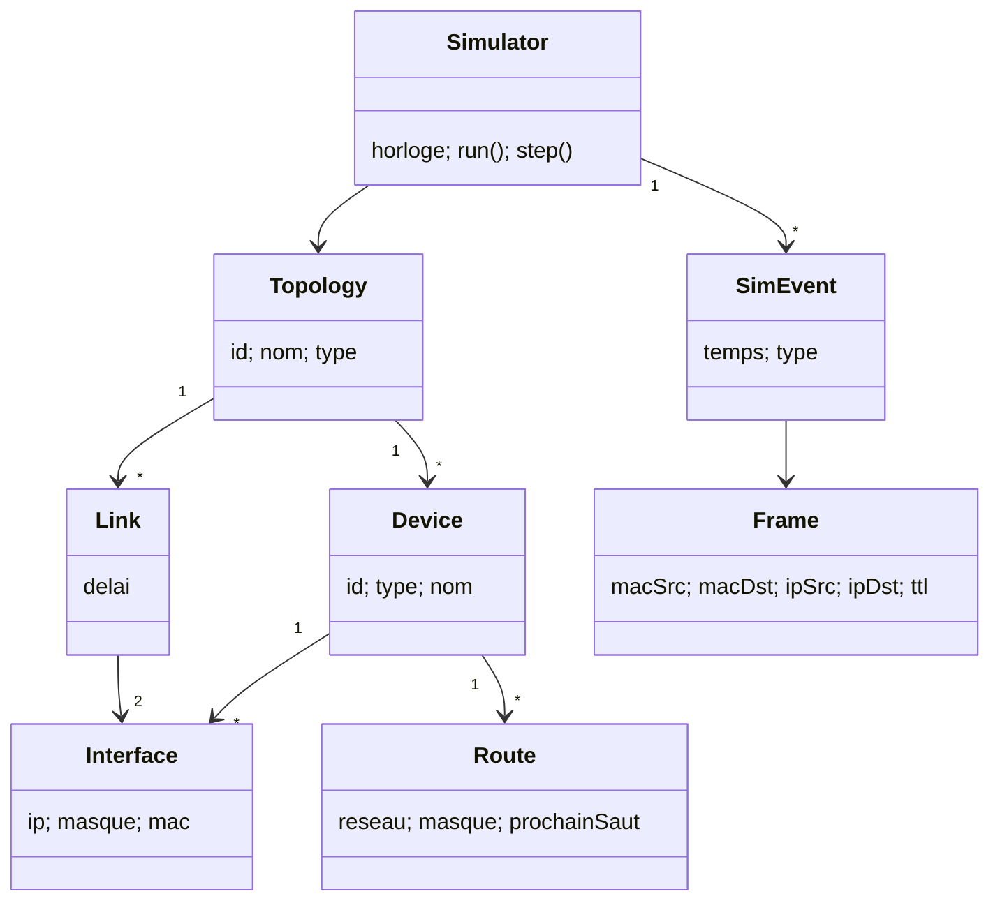
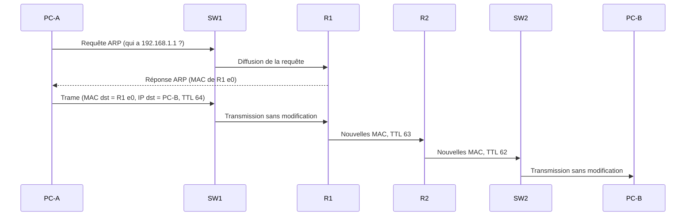
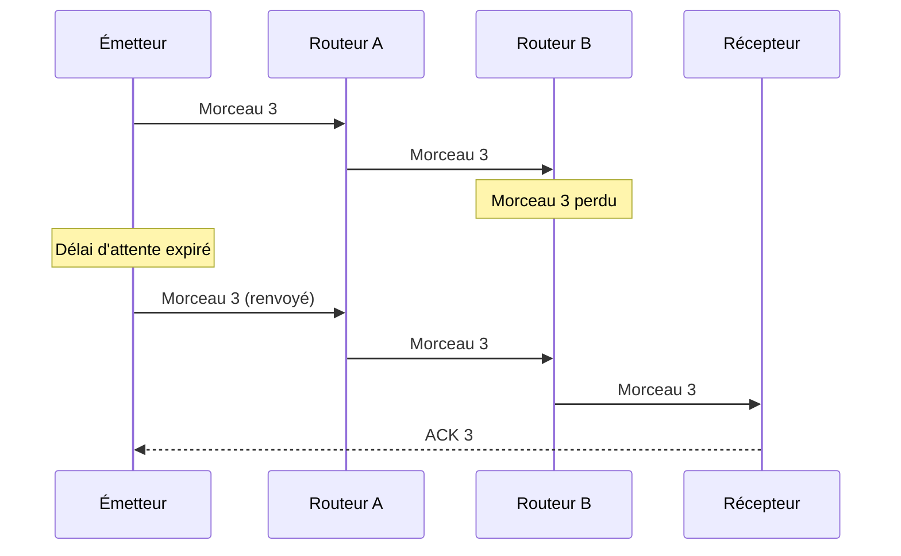
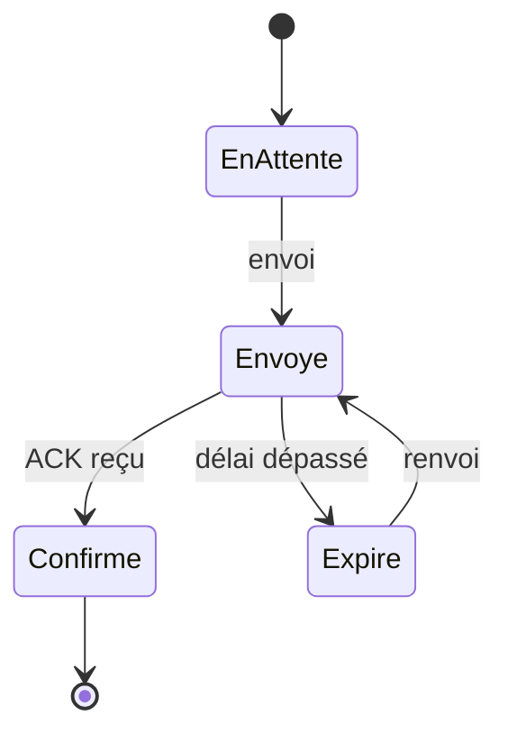

# PacketLab — Description détaillée du projet

> **Apprendre les réseaux en voyant voyager les paquets : topologies, adresses, routeurs et switchs, sans configuration.**

| | |
|---|---|
| **Projet** | Projet Web — SUP'COM |
| **Groupe** | Groupe 2 : Nour El Houda Fodha, Baha Eddine Khantouch |
| **Enseignante** | Mme Nesrine Zaghdoud |
| **Année universitaire** | 2026/2027 |
| **Type de site** | Application web éducative et interactive |
| **Étape actuelle** | Objectif 1 (définition et cadrage fonctionnel) présenté ; ce document détaille la suite |
| **Ancien nom de travail** | HopByHop (le module « Labo fiabilité » en est issu) |

---

## 1. Résumé

PacketLab est une application web éducative qui permet à un étudiant de choisir une topologie réseau déjà préparée, d'envoyer un paquet et de le suivre pas à pas jusqu'à destination, en voyant à chaque saut les adresses MAC et IP, ainsi que les tables ARP, MAC et de routage des équipements. Un second laboratoire montre ce qui se passe quand le réseau perd ou retarde des paquets, et comment un mécanisme d'acquittement et de retransmission permet de reconstruire le message. Des cours PDF, des fiches de révision et des quiz complètent l'apprentissage.

En une phrase : **PacketLab rend visible ce qui se passe entre l'envoi et la réception d'un paquet.**

---

## 2. Contexte et problématique

**Le constat.** Le routage, la commutation et l'adressage sont des notions abstraites. Dans un cours classique, l'étudiant voit des schémas statiques : il apprend que « la MAC change à chaque routeur » sans jamais le voir se produire.

**Les outils existants** (Cisco Packet Tracer, GNS3, Wireshark) sont puissants mais demandent :

- une installation logicielle ;
- une longue configuration (adresses, interfaces, routes) avant de voir le moindre paquet ;
- un bon niveau technique pour interpréter ce qu'ils affichent.

Pour un débutant, l'effort de configuration masque le phénomène à comprendre.

**Notre réponse.** L'étudiant choisit une topologie, tout est déjà configuré : il observe ce qui se passe entre les équipements et comment le paquet arrive à destination. Il peut ensuite provoquer des incidents (perte, retard) pour comprendre la fiabilité.

---

## 3. Type de site et justification du choix

**Application web éducative et interactive.**

- **Proche de notre formation** : télécommunications et réseaux, donc un sujet que nous pouvons expliquer et défendre.
- **Utilisable dans un navigateur, sans installation**, sur ordinateur comme sur téléphone.
- **Réaliste dans le temps imparti** : pas de données externes, pas de partenaires, tout est préparé par nous.
- **Valeur ajoutée claire** : voir les adresses et les tables évoluer, plutôt que les lire dans un cours.

---

## 4. Objectifs principaux

| # | Objectif | Description |
|---|---|---|
| 1 | **Visualiser** | Voir un paquet voyager de la source à la destination à travers la topologie. |
| 2 | **Comprendre** | Suivre le changement (ou non) des adresses d'un routeur à l'autre et d'un switch à l'autre. |
| 3 | **Simplifier** | Proposer des topologies préparées, sans configuration manuelle à faire. |
| 4 | **Évaluer** | Compléter l'apprentissage avec des cours PDF, des fiches et des quiz. |
| 5 | **Expérimenter la fiabilité** *(ajout)* | Provoquer pertes et retards, et comparer la livraison avec et sans retransmission. |

**Indicateurs de succès** (présentés en Objectif 1) : nombre de visiteurs, simulations lancées, quiz terminés et scores moyens.

> Remarque : sans backend, ces indicateurs ne peuvent être mesurés que localement (par navigateur). Pour des statistiques globales, il faudrait un outil d'analyse ou une petite base de données (voir § 17, points à confirmer).

---

## 5. Public cible

**Profil**

- Étudiants en réseaux et télécoms, environ 18–25 ans.
- Niveau débutant à intermédiaire.
- Public secondaire : enseignants qui illustrent leurs cours en projetant une simulation.

**Attentes**

- Comprendre vite, avec des visuels animés.
- Expérimenter sans configurer.
- Retrouver cours, fiches et quiz au même endroit.
- S'auto-évaluer et voir sa progression.

**Conséquences UX/UI**

- Interface claire, peu de texte à l'écran pendant la simulation.
- Animations pas à pas, contrôlables (lecture, pause, retour, étape suivante).
- Design responsive : la topologie se réorganise sur petit écran.
- Interface réactive : l'état de la simulation et l'affichage restent toujours synchronisés.

---

## 6. Concept : trois modules

| Module | Question à laquelle il répond | Contenu |
|---|---|---|
| **A. Voyage d'un paquet** | « Comment un paquet trouve-t-il son chemin, et que deviennent ses adresses ? » | Topologies, parcours pas à pas, adresses MAC/IP, tables ARP, MAC et de routage |
| **B. Labo fiabilité** *(ex-HopByHop)* | « Que se passe-t-il quand le réseau perd ou retarde des paquets ? » | Découpage d'un message, pertes, retards, désordre, ACK et retransmission, comparaison |
| **C. Apprendre et s'évaluer** | « Ai-je compris ? » | Cours PDF, fiches de révision, quiz QCM avec correction, progression |

Les modules sont reliés : chaque cours renvoie vers la simulation correspondante, et chaque quiz peut proposer « revoir dans le simulateur ».

---

## 7. Fonctionnalités détaillées

### 7.1 Module A — Voyage d'un paquet

**a) Simulateur de topologies**

Topologies préparées, choisies en un clic :

| Topologie | Ce qu'elle montre |
|---|---|
| **Étoile** | Plusieurs PC reliés à un switch : la commutation par adresse MAC |
| **Bus** | Un support partagé : la trame est vue par toutes les stations, seule la destinataire la garde |
| **Anneau** | La trame passe de station en station jusqu'à la destination |
| **Maillée** | Plusieurs chemins possibles entre routeurs : rôle de la table de routage |
| **Mixte** | Deux réseaux locaux en étoile reliés par des routeurs : le cas le plus réaliste |

Chaque topologie est un fichier de scénario (JSON) qui contient les équipements, leurs interfaces, leurs adresses et les tables pré-remplies. L'utilisateur choisit la source et la destination parmi les machines proposées.

**b) Parcours d'un paquet**

- Animation pas à pas du paquet (ou de la trame) sur les liens.
- Contrôles : lecture, pause, étape suivante, étape précédente, rejouer, vitesse.
- Mise en évidence de l'équipement actif et du lien emprunté.
- Journal des événements en langage clair, par exemple « R1 : TTL 64 → 63, sortie par l'interface e1 ».

**c) Suivi des adresses et des tables**

À chaque saut, un panneau affiche :

- l'en-tête de la trame : MAC source et MAC destination ;
- l'en-tête du paquet : IP source, IP destination, TTL ;
- la table consultée par l'équipement actif :
  - **PC** : table ARP (et requête ARP si l'adresse MAC est inconnue) ;
  - **switch** : table MAC (apprentissage de l'adresse source, transmission ou inondation) ;
  - **routeur** : table de routage (choix de la route, décrémentation du TTL, réécriture des adresses MAC).

**Points pédagogiques mis en évidence** (affichés sous forme de bulles) :

1. **Un switch ne modifie pas les adresses** : il lit la MAC destination et choisit le port.
2. **Un routeur réécrit les adresses MAC** à chaque saut, mais **les adresses IP restent les mêmes** de bout en bout (sans NAT).
3. **Le TTL diminue de 1** à chaque routeur traversé.
4. **ARP** permet de trouver l'adresse MAC correspondant à une IP sur le réseau local.

**Exemple travaillé (topologie mixte, adresses fictives)**

Topologie : PC-A — SW1 — R1 — R2 — SW2 — PC-B

| Équipement | Interface | IP | MAC (fictive) |
|---|---|---|---|
| PC-A | eth0 | 192.168.1.10/24 (passerelle 192.168.1.1) | AA:AA:AA:00:00:0A |
| R1 | e0 | 192.168.1.1/24 | 11:11:11:00:00:01 |
| R1 | e1 | 10.0.0.1/30 | 11:11:11:00:00:02 |
| R2 | e0 | 10.0.0.2/30 | 22:22:22:00:00:01 |
| R2 | e1 | 192.168.2.1/24 | 22:22:22:00:00:02 |
| PC-B | eth0 | 192.168.2.20/24 | BB:BB:BB:00:00:0B |

| Tronçon | MAC source | MAC destination | IP source | IP destination | TTL |
|---|---|---|---|---|---|
| PC-A → SW1 → R1 | AA:…:0A (PC-A) | 11:…:01 (R1 e0) | 192.168.1.10 | 192.168.2.20 | 64 |
| R1 → R2 | 11:…:02 (R1 e1) | 22:…:01 (R2 e0) | 192.168.1.10 | 192.168.2.20 | 63 |
| R2 → SW2 → PC-B | 22:…:02 (R2 e1) | BB:…:0B (PC-B) | 192.168.1.10 | 192.168.2.20 | 62 |

Ce tableau est exactement ce que l'étudiant voit se construire étape par étape : les MAC changent à chaque routeur, les IP ne changent jamais, le TTL diminue.

### 7.2 Module B — Labo fiabilité (ex-HopByHop)

**Principe.** L'utilisateur tape un message, par exemple « Rendez-vous à SUP'COM à 10h ». L'application le découpe en morceaux numérotés qui traversent un petit réseau fixe : émetteur → routeur A → routeur B → récepteur.

**Fonctionnalités**

- **Découpage et reconstruction** : le récepteur affiche des cases qui se remplissent ; un morceau manquant laisse un trou visible.
- **Script d'incidents** (défini avant le lancement) : perdre le morceau n°X, retarder le morceau n°Y (ce qui provoque une arrivée dans le désordre).
- **Deux modes** :
  - *Sans récupération* : chaque morceau est envoyé une seule fois ;
  - *Avec récupération* : le récepteur confirme chaque morceau reçu (ACK) ; l'émetteur renvoie tout morceau non confirmé après un délai (timeout).
- **Comparaison côte à côte** des deux modes avec le même script d'incidents : temps total, nombre de transmissions, nombre de retransmissions, message complet ou non.
- **Rejeu identique** : le même scénario produit toujours exactement la même exécution.
- **Panneau « À propos du modèle »** : liste des simplifications (ce n'est pas une implémentation de TCP).

### 7.3 Module C — Apprendre et s'évaluer

| Fonctionnalité | Description |
|---|---|
| **Cours PDF** | Un cours par concept (adressage IP, adresses MAC, ARP, commutation, routage, topologies, fiabilité), à consulter dans le navigateur ou à télécharger |
| **Fiches d'apprentissage** | Résumés courts (une page écran) pour réviser l'essentiel, avec un lien « voir dans le simulateur » |
| **Quiz d'évaluation** | QCM par thème, avec correction détaillée après chaque question et score final |
| **Questions liées à la simulation** | Exemple : « Quelle sera la MAC destination au prochain saut ? » posée pendant une simulation en pause |
| **Progression** | Quiz réalisés, meilleurs scores, simulations lancées, enregistrés dans le navigateur |

### 7.4 Priorités (périmètre)

| Priorité | Contenu | Statut |
|---|---|---|
| **P1 — indispensable** | Module A avec 3 topologies (étoile, mixte, maillée), parcours pas à pas, panneau adresses et tables, 2 quiz, responsive | À livrer en premier |
| **P2 — important** | Topologies bus et anneau, fiches de révision, cours PDF, page progression | Ensuite |
| **P3 — valeur ajoutée** | Module B (Labo fiabilité) complet avec comparaison | Si le temps le permet, sinon version réduite (un seul mode de perte) |
| **Bonus** | Questions intégrées à la simulation, mode « enseignant » plein écran, application installable (PWA), lien partageable d'un scénario | Optionnel |

**Explicitement exclu** : éditeur libre de topologie, configuration manuelle des équipements, capture du trafic réel de l'utilisateur, protocoles de routage dynamiques (RIP, OSPF), contrôle de congestion TCP, comptes utilisateurs avec mot de passe.

---

## 8. Parcours utilisateur type

1. L'étudiant arrive sur l'accueil et choisit « Voyage d'un paquet ».
2. Il sélectionne la topologie **mixte**, puis PC-A comme source et PC-B comme destination.
3. Il lance la simulation : PC-A constate que PC-B n'est pas dans son réseau et envoie une requête ARP pour trouver la MAC de sa passerelle.
4. Il avance étape par étape et voit le switch transmettre sans modifier les adresses, puis R1 réécrire les MAC et décrémenter le TTL.
5. Une question apparaît en pause : « Quelle sera la MAC destination après R2 ? ». Il répond et reçoit la correction.
6. Il ouvre la fiche « Rôle du routeur », puis passe le quiz « Routage ».
7. Il passe au **Labo fiabilité**, perd volontairement un morceau, et compare les deux modes.
8. Sa page **Progression** affiche ses scores et simulations.

---

## 9. Pages de l'application

| Page | Contenu |
|---|---|
| Accueil | Présentation, accès aux trois modules, reprise de la dernière activité |
| Simulateur (Module A) | Choix de topologie, zone de dessin, contrôles, panneau adresses et tables, journal |
| Labo fiabilité (Module B) | Message, script d'incidents, choix du mode, vue réseau, vue récepteur, comparaison |
| Cours | Liste des cours PDF (consulter / télécharger) |
| Fiches | Liste des fiches de révision |
| Quiz | Choix du thème, déroulé question par question, correction, score |
| Progression | Statistiques personnelles |
| À propos | Modèle simplifié, hypothèses, équipe, crédits |

---

## 10. Architecture technique

### 10.1 Choix technologiques

| Élément | Choix | Justification |
|---|---|---|
| Structure et style | HTML, CSS | Imposés par le cours |
| Logique | JavaScript (obligatoire) | Moteur de simulation, interface, quiz |
| Dessin des topologies | SVG | Net à toutes les tailles, animable, cliquable |
| Données | Fichiers JSON (topologies, quiz, fiches) | Contenu préparé par nous, facile à modifier |
| Persistance | `localStorage` | Progression sans serveur |
| Cours | Fichiers PDF statiques | Consultés par le lecteur PDF du navigateur |
| Hébergement | GitHub Pages ou Netlify | Gratuit, lien public pour le CV |
| Framework | Les slides mentionnent React ou Vue.js | **À confirmer avec l'enseignante** : JavaScript sans framework suffit pour ce projet |

**Un backend n'est pas nécessaire** : tout le contenu est préparé à l'avance et chaque utilisateur travaille seul. Un backend n'aurait de sens que pour des statistiques globales ou un classement, qui ne sont pas indispensables.

### 10.2 Vue d'ensemble

**Principe clé : les vues ne lisent que le journal.** Le moteur calcule toute la simulation sous forme d'une liste d'événements datés ; l'animation ne fait que rejouer cette liste. Résultat : pause, retour en arrière et rejeu sont simples et toujours cohérents.

### 10.3 Moteur de simulation à événements discrets

Au lieu de minuteries réelles, le moteur garde une **file d'événements triée par temps simulé** (« la trame arrive à SW1 à t = 20 ms »). Il prend l'événement le plus proche, l'applique, et ajoute les événements qui en découlent.

**Règles du Module A**

- **PC émetteur** : si la destination est dans son sous-réseau, il cherche sa MAC ; sinon il cherche la MAC de sa passerelle. Si la MAC est absente de sa table ARP, il envoie d'abord une requête ARP (diffusion).
- **Switch** : il apprend la MAC source et le port d'arrivée ; si la MAC destination est connue, il transmet sur le bon port, sinon il diffuse sur tous les autres ports.
- **Routeur** : il décrémente le TTL, cherche la route correspondant à l'IP destination, réécrit la MAC source (son interface de sortie) et la MAC destination (prochain saut), puis transmet.
- **Bus** : la trame est reçue par toutes les stations ; seule la destinataire la traite.
- **Anneau** : la trame passe de station en station dans un sens jusqu'à la destination.

**Règles du Module B**

- L'émetteur envoie les morceaux ; en mode récupération, il arme un délai d'attente pour chacun.
- Un morceau marqué « perdu » dans le script disparaît à l'endroit prévu ; un morceau « retardé » reçoit un délai supplémentaire.
- Le récepteur range chaque morceau à sa place et envoie un ACK ; le message est reconstruit quand toutes les cases sont pleines.
- Si le délai d'attente expire sans ACK, l'émetteur renvoie le morceau.

---

## 11. Modèle de données

| Entité | Champs principaux | Rôle |
|---|---|---|
| **Topology** | id, nom, type (étoile, bus, anneau, maillée, mixte), devices, links | Un scénario prêt à l'emploi |
| **Device** | id, type (PC, switch, routeur), nom, position, interfaces | Un équipement |
| **Interface** | nom, ip, masque, mac, lien | Une carte réseau |
| **Link** | id, extrémité A, extrémité B, délai | Un câble |
| **ArpEntry** | ip, mac | Ligne de table ARP (PC, routeur) |
| **MacEntry** | mac, port | Ligne de table MAC (switch) |
| **Route** | réseau, masque, prochain saut, interface | Ligne de table de routage |
| **Frame / Packet** | macSrc, macDst, ipSrc, ipDst, ttl, type (données, ARP), numéro | Ce qui circule |
| **SimEvent** | temps, type (envoi, arrivée, ARP, perte, ACK, timeout), équipement, contenu | Une étape du journal |
| **Simulator** | horloge, file, journal, scénario | Exécute la simulation |
| **RunResult** | complet, temps total, transmissions, retransmissions | Résultat d'une exécution (Module B) |
| **Quiz / Question / Choice** | thème, énoncé, choix, bonne réponse, explication | Évaluation |
| **Sheet / Course** | titre, thème, contenu ou fichier, lien simulation | Contenus pédagogiques |
| **Progress** | quiz faits, scores, simulations lancées | Progression (localStorage) |

---

## 12. Diagrammes UML à produire

### 12.1 Cas d'utilisation (à dessiner dans l'outil UML)

- **Acteur Étudiant** : choisir une topologie ; lancer et contrôler une simulation ; consulter les adresses et tables ; lancer le Labo fiabilité ; consulter un cours ou une fiche ; passer un quiz ; voir sa progression.
- **Acteur Enseignant** : projeter une simulation en plein écran ; utiliser les scénarios pour illustrer un cours.

### 12.2 Diagramme de classes (simplifié)

### 12.3 Diagramme de séquence : PC-A envoie à PC-B (réseau différent)

### 12.4 Diagramme de séquence : morceau perdu puis retransmis (Module B)

### 12.5 Diagramme d'états : un morceau (Module B)

---

## 13. Interface et identité visuelle

- **Logo** : fiole de laboratoire contenant un paquet (cube), entourée d'équipements reliés en anneau.
- **Palette** (reprise du logo, valeurs à extraire du fichier source) : bleu marine (fond, titres), bleu (actions), cyan (paquet en mouvement, éléments actifs), violet (accents, dégradés).
- **Style** : moderne et technologique, fonds sombres pour les zones de simulation, fonds clairs pour les contenus de lecture.
- **Codes visuels de la simulation** :
  - équipement actif en surbrillance cyan ;
  - adresse qui vient de changer surlignée dans le panneau ;
  - paquet perdu marqué d'une croix, retransmission tracée en violet.
- **Responsive** : sur téléphone, la topologie passe au-dessus et le panneau d'adresses en dessous, en onglets.

---

## 14. Inspirations et positionnement

| Référence | Ce que nous en retenons | Ce que PacketLab fait différemment |
|---|---|---|
| **Cisco Packet Tracer** | Vue topologie, mode simulation des paquets | Aucune installation ni configuration ; tout est préparé |
| **GNS3 et Wireshark** | Détail des trames et des en-têtes | Seuls les champs utiles au débutant, expliqués à chaque saut |
| **VisuAlgo** | Animations pas à pas pour apprendre | Appliqué aux réseaux, avec quiz et fiches intégrés |

**Originalité** : PacketLab n'est pas une invention mondiale (des simulateurs éducatifs existent). Son angle propre est la combinaison « zéro configuration + adresses et tables expliquées à chaque saut + laboratoire de fiabilité + cours et quiz au même endroit », dans un navigateur.

---

## 15. Planning indicatif (4 semaines, 2 personnes)

| Semaine | Nour El Houda | Baha Eddine | Point de contrôle |
|---|---|---|---|
| 1 | Maquettes (ordinateur et téléphone), diagramme de cas d'utilisation, format JSON des topologies | Moteur : file d'événements, règles PC et switch ; test sans affichage | Une trame traverse une étoile dans le journal |
| 2 | Vue SVG, contrôles de lecture, panneau adresses et tables | Règles routeur et ARP, topologies mixte et maillée | Exemple travaillé (§ 7.1) affiché pas à pas |
| 3 | Quiz, fiches, page progression, responsive | Topologies bus et anneau ; Module B (pertes, ACK, comparaison) | Les trois modules fonctionnent |
| 4 | Cours PDF, finitions visuelles, documentation | Corrections, diagrammes de classes, séquence et états, déploiement | Démo répétée, lien en ligne |

Chacun doit pouvoir expliquer la partie de l'autre lors de la soutenance.

**Estimation d'effort (personnes-heures, estimation)**

| Tâche | Heures |
|---|---|
| Moteur Module A (règles PC, switch, routeur, ARP) | 7 |
| Interface simulateur (SVG, contrôles, panneaux) | 8 |
| Préparation des 5 topologies (JSON) | 3 |
| Module B (Labo fiabilité) | 6 |
| Quiz, fiches, progression | 5 |
| Cours PDF (rédaction) | 4 |
| Tests | 3 |
| Documentation et UML | 4 |
| Déploiement et préparation de la soutenance | 2 |
| **Total** | **42** |

> **Attention** : ce total dépasse le budget initial de 32 personnes-heures. C'est pourquoi le périmètre est priorisé (§ 7.4) : si le temps manque, le Module B passe en version réduite et les cours PDF se limitent aux thèmes principaux.

---

## 16. Risques et parades

| Risque | Probabilité | Parade |
|---|---|---|
| Le périmètre « tout inclus » dépasse le temps disponible | Élevée | Priorités P1 → P3 ; geler la liste des fonctionnalités en semaine 1 |
| L'animation et la logique se désynchronisent | Moyenne | Moteur à événements ; les vues ne lisent que le journal |
| Erreur réseau visible par le jury (adresses, TTL, ARP) | Moyenne | Exemple travaillé vérifié à la main ; relecture par rapport au cours de réseaux |
| Ressemble à une simple animation | Moyenne | Journal visible, tables qui évoluent, questions pendant la simulation |
| Topologie illisible sur téléphone | Faible | Disposition verticale et onglets |
| Contenu des cours trop long à rédiger | Moyenne | Fiches courtes en priorité ; cours PDF limités aux thèmes P1 |

---

## 17. Points à confirmer

- [ ] Framework : JavaScript sans framework, ou React/Vue autorisé ? (les slides mentionnent React/Vue)
- [ ] Budget horaire réel : 4 h par semaine par personne ou pour le binôme ?
- [ ] Dates des prochains objectifs (Objectif 2, livraison, soutenance).
- [ ] Indicateurs de succès : suffit-il de les mesurer localement, ou faut-il une statistique globale ?
- [ ] Sources des cours PDF : rédigés par nous à partir de nos supports de cours (à citer).

---

## 18. Démonstration prévue (5 minutes)

1. **Accueil** : présenter les trois modules en une phrase chacun.
2. **Topologie mixte, PC-A → PC-B** : montrer la requête ARP, puis le switch qui ne change rien.
3. **Pause sur R1** : faire remarquer au jury que les MAC changent, que l'IP reste la même et que le TTL baisse.
4. **Question intégrée** : répondre en direct à « quelle MAC au prochain saut ? ».
5. **Labo fiabilité** : perdre le morceau 3 sans récupération (le message reste troué), puis avec récupération (timeout, renvoi, message complet) ; afficher la comparaison.
6. **Quiz** : une question avec sa correction détaillée, puis la page progression.

---

## 19. Valeur pour le CV

**Compétences visibles** : développement web front-end (HTML, CSS, JavaScript), visualisation SVG, conception d'un moteur de simulation, modélisation de protocoles réseau (Ethernet, ARP, IP, ACK/retransmission), conception pédagogique, documentation UML, déploiement.

**Exemple de ligne de CV (une fois le travail réalisé)** :
*« Conception et développement de PacketLab, application web éducative (HTML/CSS/JavaScript) simulant pas à pas le parcours d'un paquet dans des topologies préparées, avec suivi des adresses MAC/IP et des tables ARP, MAC et de routage, laboratoire de pertes et retransmissions, et quiz intégrés. »*

**À ne pas prétendre** : « implémente TCP/IP », « remplace Packet Tracer », nombre d'utilisateurs non mesuré.

---

## 20. Glossaire

| Terme | Définition simple |
|---|---|
| **Adresse IP** | Adresse logique d'une machine sur le réseau (ex. 192.168.1.10) ; reste la même de bout en bout |
| **Adresse MAC** | Adresse physique d'une carte réseau ; utilisée sur un seul tronçon local |
| **ARP** | Protocole qui trouve l'adresse MAC correspondant à une adresse IP sur le réseau local |
| **Switch** | Équipement qui transmet les trames selon l'adresse MAC, sans les modifier |
| **Routeur** | Équipement qui relie des réseaux différents et choisit le chemin selon l'adresse IP |
| **Table de routage** | Liste des réseaux connus d'un routeur et de la sortie à utiliser pour chacun |
| **TTL** | Compteur décrémenté à chaque routeur ; le paquet est détruit à 0 (évite les boucles) |
| **Trame / paquet** | La trame est l'enveloppe locale (MAC) ; le paquet est le contenu routé (IP) |
| **ACK** | Accusé de réception envoyé par le récepteur pour confirmer un morceau |
| **Timeout** | Délai au bout duquel l'émetteur renvoie un morceau non confirmé |
| **Simulation à événements discrets** | Simulation qui avance d'événement en événement selon un temps simulé, sans minuterie réelle |
